<p align="center">
  
</p>

<h1 align="center">Thorax AI · Medical Image Analysis</h1>

<p align="center">
  An educational chest X-ray classification project built with TensorFlow, MobileNetV2, and Streamlit.
</p>

<p align="center">
  <strong>Research and education only · Not a medical device · Not for diagnosis or care decisions</strong>
</p>

---

## 👋 Project overview

Thorax AI demonstrates an end-to-end machine-learning workflow for classifying images into the labels `NORMAL` and `PNEUMONIA` from a public chest X-ray dataset. It includes dataset inspection, transfer-learning training, held-out evaluation, command-line inference, and a local Streamlit demo.

This is a classroom software project—not a clinical system, a simulation of clinical practice, or evidence of real-world diagnostic performance. Model outputs are not calibrated clinical probabilities. Do not use them to diagnose, triage, treat, or make decisions about a person.

## ✨ What the project demonstrates

- A TensorFlow input pipeline with stable class mapping: `NORMAL` = 0 and `PNEUMONIA` = 1.
- 224 × 224 RGB image resizing, batching, and prefetching.
- Training-only random rotation and zoom augmentation.
- A frozen ImageNet-pretrained MobileNetV2 feature extractor and binary classification head.
- Validation-based checkpoint selection and early stopping.
- Held-out test evaluation with accuracy, sensitivity, specificity, ROC AUC, and a confusion matrix.
- Dataset inspection for image counts and unreadable files.
- A local Streamlit interface for educational exploration.
- Automated unit tests for the data pipeline, dataset inspection, and plotting utilities.

## 🏗️ System architecture

```text
Dataset folders: train / val / test
             NORMAL / PNEUMONIA
                    │
                    ▼
       Decode · resize to 224 × 224 RGB
                    │
          ┌─────────┴──────────┐
          │                    │
          ▼                    ▼
 Training-only augmentation   Validation / test
          │                    │
          └─────────┬──────────┘
                    ▼
    Frozen ImageNet MobileNetV2
                    │
                    ▼
 Global average pooling · dropout
                    │
                    ▼
       Sigmoid class score
          ┌─────────┴─────────┐
          ▼                   ▼
 Held-out evaluation    Local Streamlit demo
```

The training pipeline uses the supplied training split to fit the model and the validation split for checkpoint selection and early stopping. The held-out test split is reserved for final evaluation.

## 🔬 Model and recorded evaluation

The classifier uses MobileNetV2 with ImageNet weights as a frozen feature extractor, followed by global average pooling, dropout, and a sigmoid output. The demo uses a fixed score threshold of `0.5` to display its model prediction.

One recorded held-out run produced these results:

| Measure | Result |
|---|---:|
| Accuracy | 76.3% |
| Pneumonia sensitivity | 98.5% |
| Normal specificity | 39.3% |
| ROC AUC | 0.950 |
| Threshold | 0.5 |

The confusion matrix for that run was:

| Dataset label \ Model prediction | NORMAL | PNEUMONIA |
|---|---:|---:|
| NORMAL | 92 | 142 |
| PNEUMONIA | 6 | 384 |

**Interpret carefully:** 142 of 234 NORMAL test images were classified as PNEUMONIA at this threshold. The low NORMAL specificity is important and is shown in the app. The validation split in this dataset contains only 16 images, so its validation metrics are coarse and unstable. These dataset- and run-specific results do not establish calibration, clinical utility, or generalization.

## 📸 Project screenshots

The gallery shows the app and development workflow. The individual chest X-ray captures (screenshots 06–09) are not embedded here: check the dataset's current terms before sharing or publishing any image from it. Never upload identifiable or private patient images.

<details>
<summary>App and model results</summary>

<table>
<tr>
<td><a href="screenshots/01_thorax_ai_home.png">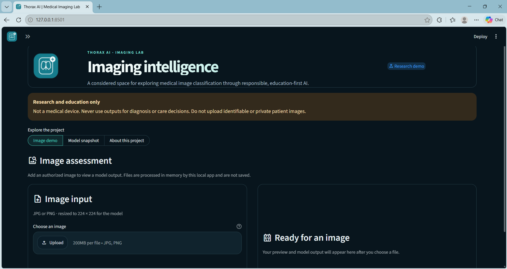</a><br><sub>01 · Home screen and safety notice</sub></td>
<td><a href="screenshots/02_model_metrics.png">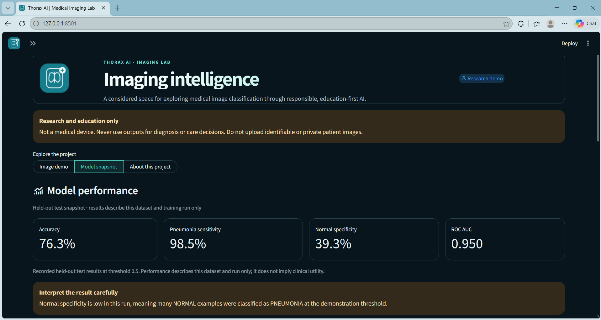</a><br><sub>02 · Model metrics and caution</sub></td>
</tr>
<tr>
<td><a href="screenshots/03_confusion_matrix.png">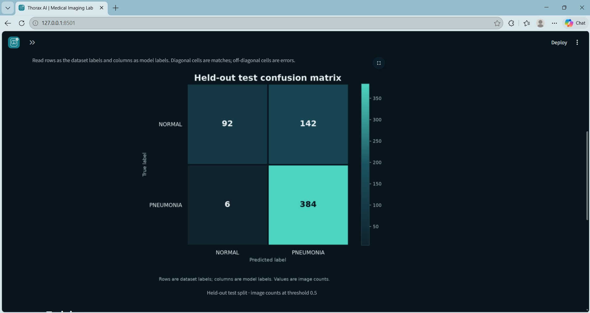</a><br><sub>03 · Confusion matrix</sub></td>
<td><a href="screenshots/04_training_curves.png">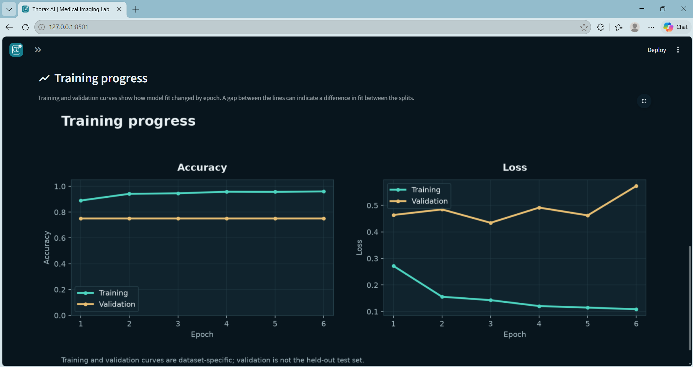</a><br><sub>04 · Training curves</sub></td>
</tr>
<tr>
<td><a href="screenshots/05_about_project.png">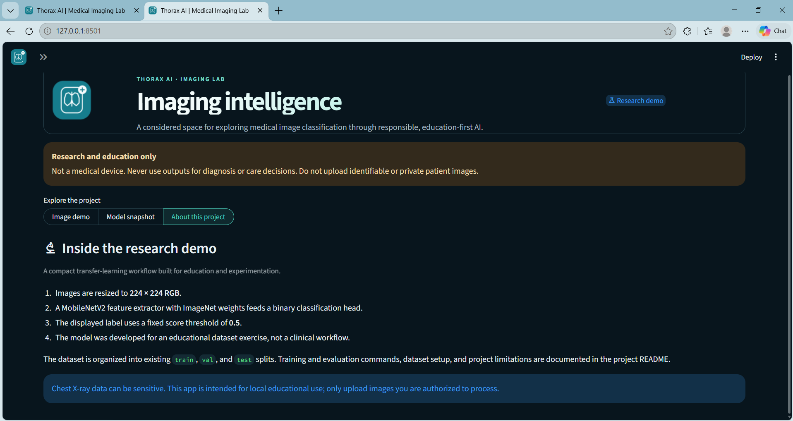</a><br><sub>05 · About the research demo</sub></td>
<td><a href="screenshots/10_project_overview.png">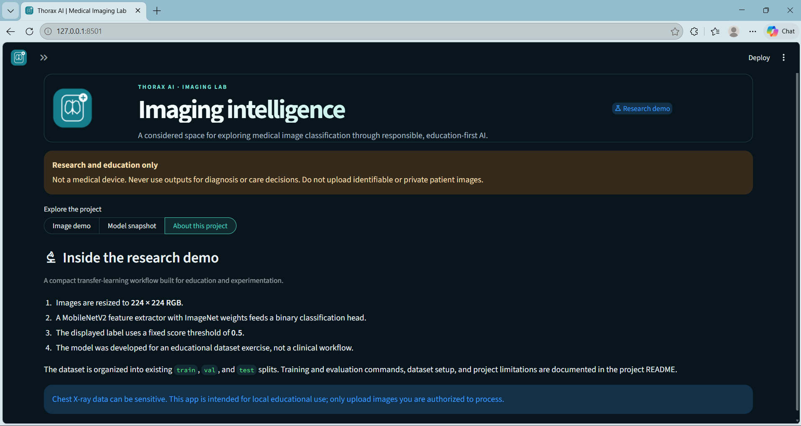</a><br><sub>10 · Project overview</sub></td>
</tr>
</table>

</details>

<details>
<summary>Code, documentation, tests, and CLI</summary>

<table>
<tr>
<td><a href="screenshots/11_project_structure.png">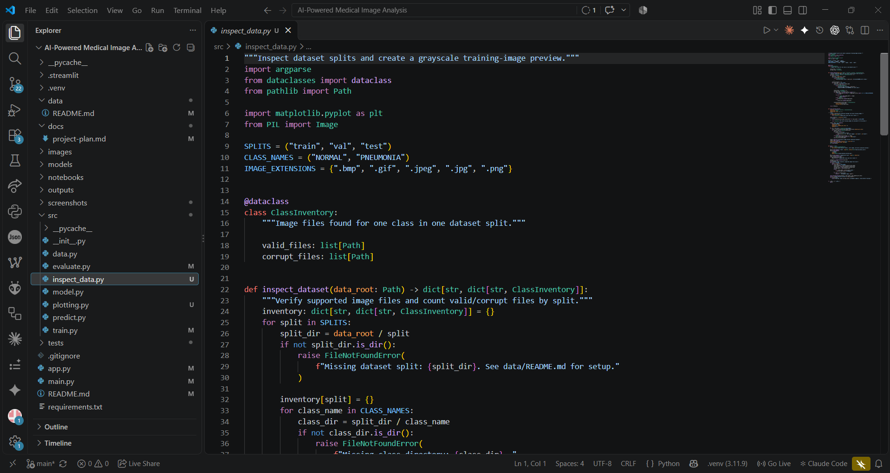</a><br><sub>11 · Project structure</sub></td>
<td><a href="screenshots/12_readme_overview.png">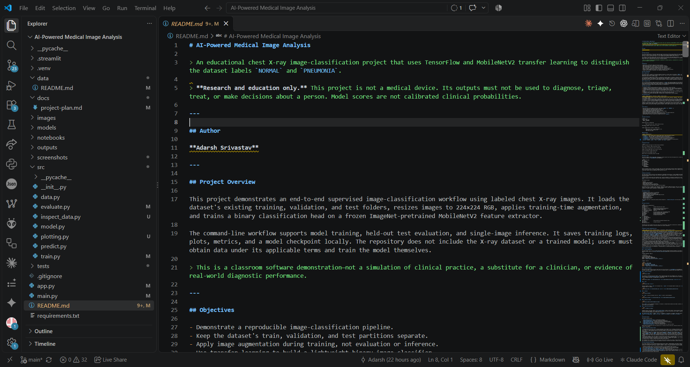</a><br><sub>12 · README overview</sub></td>
</tr>
<tr>
<td><a href="screenshots/13_readme_workflow.png">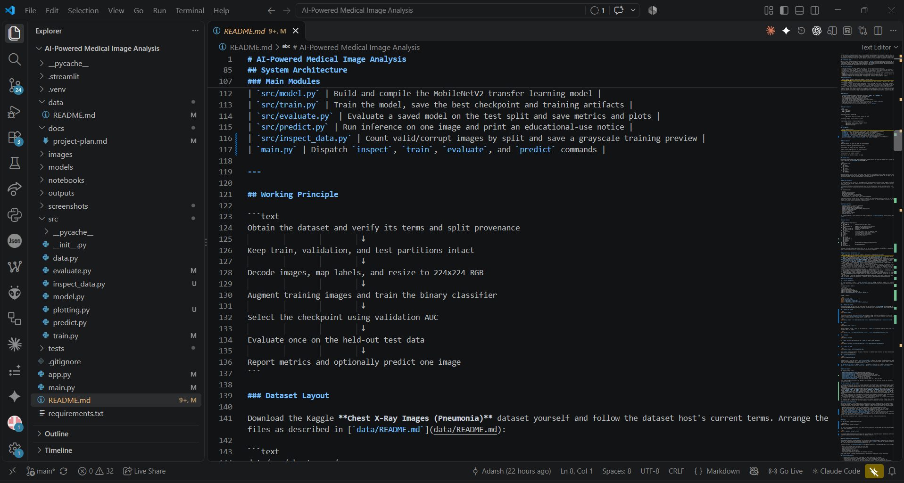</a><br><sub>13 · Modules and workflow</sub></td>
<td><a href="screenshots/14_tests_passed.png">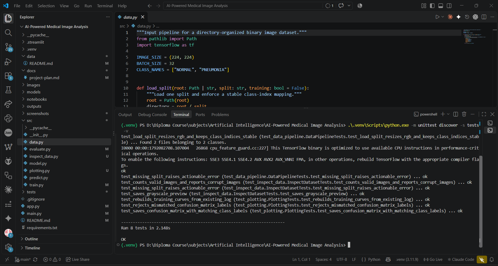</a><br><sub>14 · Eight tests passing</sub></td>
</tr>
<tr>
<td><a href="screenshots/15_cli_workflow.png">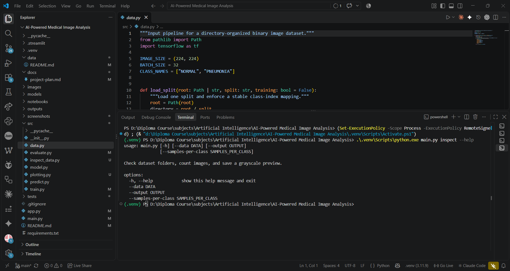</a><br><sub>15 · Dataset inspection CLI help</sub></td>
<td></td>
</tr>
</table>

</details>

## 🧭 Workflow

```text
Obtain the dataset and review its terms
                  ↓
Inspect the supplied folders and class counts
                  ↓
Keep train / validation / test splits separate
                  ↓
Resize images and augment training images only
                  ↓
Train MobileNetV2 classifier; select checkpoint on validation data
                  ↓
Evaluate once on the held-out test split
                  ↓
Explore outputs locally in the CLI or Streamlit app
```

## 📂 Dataset setup

The project expects the Kaggle [Chest X-Ray Images (Pneumonia)](https://www.kaggle.com/datasets/paultimothymooney/chest-xray-pneumonia) dataset. Obtain it yourself, review and follow the host's current terms, and preserve its supplied partitions. Dataset files and trained weights are not included in this repository.

Extract the dataset so the folders look like:

```text
data/raw/chest_xray/
├── train/
│   ├── NORMAL/
│   └── PNEUMONIA/
├── val/
│   ├── NORMAL/
│   └── PNEUMONIA/
└── test/
    ├── NORMAL/
    └── PNEUMONIA/
```

Record the dataset version, source, access date, terms, split provenance, and class counts for your run. Do not combine the splits or commit raw images. See [`data/README.md`](data/README.md) for the setup notes.

## 🚀 Getting started

### Requirements

- 64-bit Python 3.10 or 3.11.
- Packages listed in [`requirements.txt`](requirements.txt).
- The dataset in the folder layout above for inspection, training, and evaluation.
- Internet access on first training run if MobileNetV2 ImageNet weights are not already cached.

TensorFlow package availability varies by operating system and Python version. If installation fails, consult the [official TensorFlow installation guide](https://www.tensorflow.org/install/pip).

### Install

**Windows PowerShell**

```powershell
py -3.11 -m venv .venv
.\.venv\Scripts\Activate.ps1
python -m pip install --upgrade pip
python -m pip install -r requirements.txt
```

**macOS / Linux**

```bash
python3.11 -m venv .venv
source .venv/bin/activate
python -m pip install --upgrade pip
python -m pip install -r requirements.txt
```

### Inspect the dataset

```bash
python main.py inspect
```

This checks the expected folders, reports valid and unreadable image counts, and writes a grayscale preview to `outputs/dataset_preview.png`.

### Train

```bash
python main.py train --epochs 8
```

The model checkpoint is written to `models/pneumonia_mobilenet.keras`; training logs and curves are written under `outputs/`.

### Evaluate

```bash
python main.py evaluate
```

Evaluation writes run-specific metrics, a confusion matrix, and example predictions under `outputs/`. Do not tune a model against the held-out test split.

### Predict one image

```bash
python main.py predict path/to/authorized_xray.jpeg
```

Predictions are educational model outputs only. Use only images you are authorized to process.

### Launch the local web app

```bash
python -m streamlit run app.py
```

Open the local URL printed by Streamlit, usually `http://localhost:8501`. The app processes uploaded images in memory and does not write them to disk. Keep the app local; do not upload identifiable or private patient images.

## 🧪 Testing

Run the test suite from the repository root:

```powershell
python -m unittest discover -s tests -v
```

The suite covers image loading and label order, dataset inspection and corrupt-file reporting, and plot generation. The recorded run completed with **8 tests passing**.

## 📁 Project structure

```text
AI-Powered-Medical-Image-Analysis/
├── .streamlit/          # Streamlit theme
├── data/                # Dataset instructions; raw data is not included
├── docs/                # Project plan and reproducibility notes
├── images/              # Thorax AI logo and app icon
├── models/              # Locally generated model checkpoint
├── outputs/             # Locally generated logs, metrics, and plots
├── screenshots/         # Portfolio and app captures
├── src/
│   ├── data.py          # Dataset input pipeline
│   ├── evaluate.py      # Held-out test evaluation
│   ├── inspect_data.py  # Dataset inspection and preview
│   ├── model.py         # MobileNetV2 classifier
│   ├── plotting.py      # Training and evaluation plots
│   ├── predict.py       # Single-image CLI inference
│   └── train.py         # Training and checkpoint selection
├── tests/               # Unit tests
├── app.py               # Streamlit interface
├── main.py              # CLI command dispatcher
└── requirements.txt
```

Dataset images, local checkpoints, and generated outputs are not distributed as part of this project.

## 🧰 Technology stack

| Area | Tools |
|---|---|
| Language | Python |
| Deep learning | TensorFlow / Keras |
| Transfer learning | MobileNetV2 with ImageNet weights |
| Image handling | Pillow and TensorFlow |
| Metrics | scikit-learn |
| Visualization | Matplotlib |
| Local interface | Streamlit |
| Testing | `unittest` |
| Version control | Git and GitHub |

## ⚠️ Limitations and responsible use

- This is an educational research example, not a medical device or diagnostic aid.
- The sigmoid score is uncalibrated and is not a clinical probability.
- The fixed `0.5` threshold is a demonstration default, not a clinically selected operating point.
- NORMAL specificity was low in the recorded run; many NORMAL images were classified as PNEUMONIA.
- The validation split is small, and its measurements are unstable.
- Dataset labels, provenance, split construction, and representativeness may have limitations.
- There is no external validation, prospective evaluation, clinical workflow integration, regulatory review, or deployment security.
- Results from this dataset may not generalize to other hospitals, devices, populations, or workflows.
- Never upload private or identifiable patient data without appropriate authorization and safeguards.

Any future clinical application would require domain expertise, representative data, independent and prospective validation, calibration, privacy and security controls, human-factors evaluation, and applicable regulatory review.

## 🔭 Future scope

- Record dataset provenance and training configuration alongside each run.
- Expand tests for preprocessing, metrics, and inference.
- Add structured class-wise error analysis without exposing restricted images.
- Investigate split provenance, duplicate risk, and external validation where permitted data is available.
- Study threshold selection and calibration for research use, without implying clinical readiness.
- Improve reproducibility through environment and experiment tracking.

## 🎓 Skills demonstrated

- **Machine learning:** supervised image classification, transfer learning, augmentation, checkpoint selection, and held-out evaluation.
- **Python engineering:** modular project structure, CLI design, image pipelines, automated testing, and artifact generation.
- **Visualization:** training curves, confusion matrix, metric reporting, and result interpretation.
- **Responsible communication:** dataset provenance, privacy considerations, model limitations, and clear non-clinical-use boundaries.

## 👨‍💻 Author

**Adarsh Srivastav**<br>
Computer Science and Engineering student<br>
Interests: Artificial Intelligence · Computer Vision · Python

## ✅ Project status

The repository contains a working educational training/evaluation workflow and local Streamlit demonstration. Dataset files and trained model weights must be supplied or generated locally. The application has not been clinically validated.

---

**Thorax AI is a learning project. Model outputs are not medical advice and must not guide patient care.**
